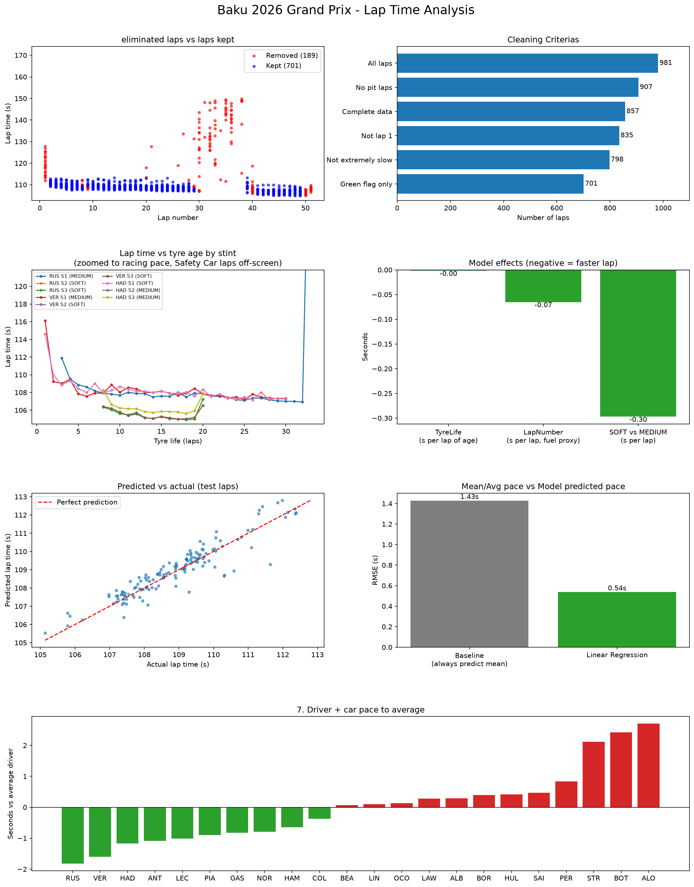

# F1 Lap Time Analysis: 2026 Azerbaijan Grand Prix (Baku)

A data analysis and machine learning project that uses real Formula 1 timing data to measure what actually drives lap time in a race: tyre compound, tyre age, fuel burn, and driver/car pace.



## What it does

1. Pulls lap-by-lap data for the 2026 Baku GP using the [FastF1](https://github.com/theOehrly/Fast-F1) library
2. Cleans the data: removes pit laps, lap 1, Safety Car / yellow-flag laps and other slow outliers
3. Trains a Linear Regression model to predict lap time from tyre age, lap number, compound and driver
4. Compares the model against a "always predict the average" baseline
5. Visualizes every step in a 7-panel dashboard

## Key findings

| Questions | Result |

Does the model beat guessing the average? 
Yes: RMSE **0.54s** vs **1.43s** baseline 

How much faster does a car get as the race goes on? 
About **0.065s per lap** (fuel burn and track evolution)

Does tyre age slow the car down at Baku? 
No measurable effect once lap number is accounted for 

Soft vs Medium compound 
Softs about **0.3s per lap** faster 

How big is the car/driver pace gap? 
About **4.5s per lap** between the fastest (RUS) and slowest (ALO) in the model 

## The cleaning story

The first model, trained on raw laps, had an RMSE of about 8.5s. The error came from laps that aren't representative racing laps: pit stops, the standing start, and a Safety Car period (130-150s laps against a ~108s baseline). Filtering these out took the data from 981 laps down to 701 clean green-flag laps and was the single biggest improvement to the model. Panel 2 of the dashboard shows how many laps each step removed.

## How it works

- **Data:** `fastf1` session data for the race, loaded with local caching
- **Features:** `TyreLife`, `LapNumber` (proxy for fuel load and track evolution), one-hot encoded `Compound` and `Driver`
- **Target:** lap time in seconds
- **Model:** scikit-learn `LinearRegression`, 80/20 train/test split
- **Evaluation:** RMSE compared against a mean-prediction baseline

Adding driver and lap number as features is what moved the model from barely beating the baseline to the final 0.54s result.

## Setup

```bash
git clone https://github.com/meetparikh522-commits/f1-lap-time-analysis.git
cd f1-lap-time-analysis

python -m venv venv
venv\Scripts\activate        # Windows
source venv/bin/activate     # macOS/Linux

pip install fastf1 pandas matplotlib scikit-learn
mkdir cache                  # FastF1 needs this folder to exist
```

## Usage

```bash
python f1_analysis.py
```

The first run downloads the race data (a minute or two). It prints the model results, opens the dashboard, and saves it as `f1_dashboard.png`.

To analyze a different race, change this line:

```python
session = fastf1.get_session(2026, 'Baku', 'R')
```

## Limitations

- **One race, one track.** The model describes what drove lap times at Baku and says nothing about other circuits.
- **Random lap split.** The test set is a random 20% of laps, so neighbouring laps from the same driver may appear in both training and test data. This likely makes the 0.54s figure somewhat optimistic.
- **Driver and car pace are combined.** Teammates get near-identical coefficients, so the driver effects mostly reflect the car, and they also include traffic.
- **`LapNumber` is a proxy.** It captures fuel burn and track evolution together; the two can't be separated with this data.
- **Tyre effects are limited.** Only Soft and Medium compounds were used, and stints were short, so the "no tyre degradation" finding applies to this race only.

## Possible next steps

- Hold out whole stints (or whole races) when testing, for a stricter evaluation
- Train on several races and test on an unseen one
- Add track temperature and weather data
- Try a tree-based model (e.g. Random Forest) to capture non-linear effects

## Tech stack

Python 3.11, FastF1, pandas, matplotlib, scikit-learn
